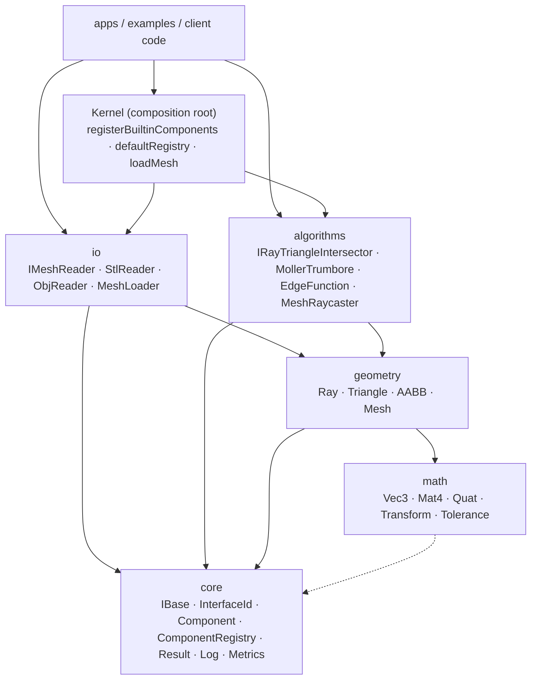
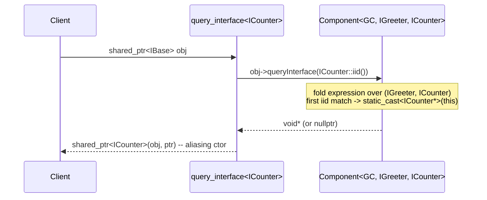
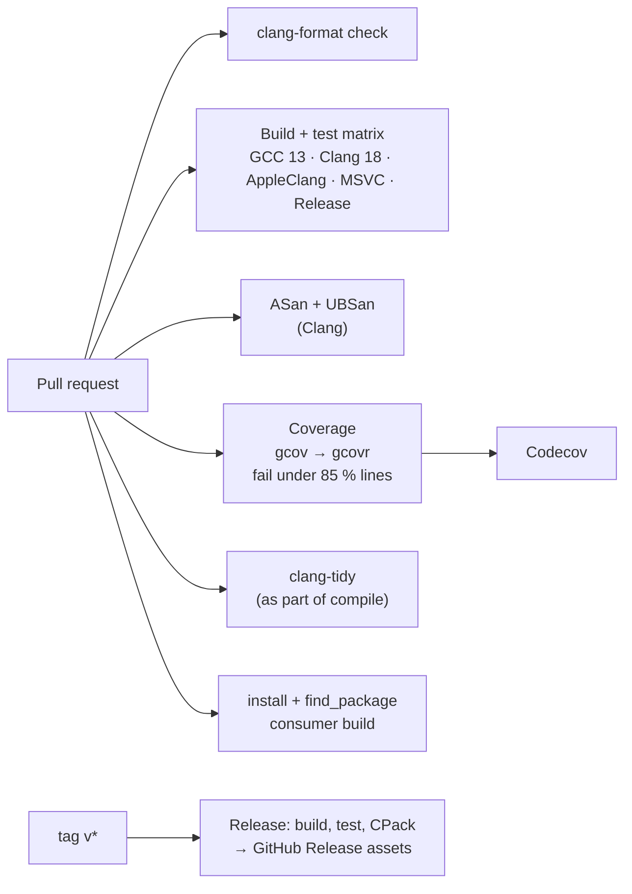

# GeoKernel Architecture

> Status: v1.0 · Audience: contributors and integrators · Decisions are recorded in [adr/](adr/).

## 1. Goals and non-goals

**Goals**

1. **Replaceable parts.** Every algorithm and file format sits behind an abstract interface and can be swapped or extended without recompiling clients (open/closed principle).
2. **Correct before fast.** Numerically careful kernels, explicit tolerances, cross-validated implementations, sanitizer-clean.
3. **Safe on hostile input.** Malformed or malicious mesh files produce an `Error`, never a crash, hang or unbounded allocation.
4. **Observable.** Every non-trivial operation is logged and counted, with zero cost when logging is off.
5. **Consumable.** One CMake target, an installable package, no third-party types in the public API.

**Non-goals (v1)**: B-rep/NURBS modelling, GPU acceleration, loading plugins from shared libraries at runtime (see §11).

## 2. Layered structure



**Dependency rule:** a module may only include headers from modules *below* it. `io` and `algorithms` are siblings and never include each other. Only `Kernel.cpp` (the composition root) names concrete components from more than one module.

| Module | Responsibility | Depends on |
|---|---|---|
| `core` | Component model, registry, error types, logging facade, metrics | — (spdlog privately) |
| `math` | Value types for linear algebra; all `noexcept`, no allocation | core (Export only) |
| `geometry` | Geometric primitives and the indexed `Mesh` container | math, core |
| `algorithms` | Queries over geometry, exposed as components | geometry, core |
| `io` | Format readers (components) and the `MeshLoader` facade | geometry, core |
| `Kernel` | Wires built-ins into a registry; convenience entry points | everything |

Physical layout mirrors the logical one: `include/geokernel/<module>/` (public API) and `src/<module>/` (implementation + private headers such as `core/LogInternal.hpp` and `io/detail/*`).

## 3. Component model (CAA-style)

GeoKernel adopts the core ideas of Dassault Systèmes' **Component Application Architecture**: clients program against *interfaces*, objects are *components* that may implement several interfaces, and capabilities are discovered at runtime by *querying* rather than by casting to concrete types.

| CAA concept | GeoKernel equivalent |
|---|---|
| `CATBaseUnknown` | `gk::core::IBase` |
| IID / `CATDeclareInterface` | `gk::core::InterfaceId` / `GK_DECLARE_INTERFACE("gk.io.IMeshReader")` |
| `QueryInterface()` | `gk::core::query_interface<I>(ptr)` |
| Implementation + TIE tables | CRTP `gk::core::Component<Self, I1, I2, ...>` generates the table at compile time |
| `AddRef` / `Release` | `std::shared_ptr` with the aliasing constructor |
| Dictionary / late typing | `gk::core::ComponentRegistry` |

### 3.1 Interfaces and identity

```cpp
class IMeshReader : public virtual core::IBase {
    GK_DECLARE_INTERFACE("gk.io.IMeshReader")   // constexpr FNV-1a hash + name
public:
    virtual core::Result<std::unique_ptr<Mesh>> read(std::istream&, const ReadOptions&) const = 0;
};
```

* Interfaces inherit **virtually** from `IBase`, so a component implementing several interfaces has exactly one `IBase` sub-object — one identity.
* `InterfaceId` is a compile-time FNV-1a hash of a reverse-DNS name. Equality compares the hash first and the name second, so it is collision-proof and does not depend on RTTI (which differs across DLL boundaries and is disabled in some deployments).

### 3.2 Querying



The returned `shared_ptr<ICounter>` **shares the control block** of the component: holding any interface keeps the whole component alive, and the last interface released destroys it. There is no manual reference counting to get wrong.

### 3.3 Why not `dynamic_cast`?

* **Stable across module boundaries** — identity is a string, not compiler-generated type info.
* **Extension point** — a component may override `queryInterface` to hand out a delegate object (the CAA "extension" pattern) without the client knowing.
* **Advertised metadata** — `Component<>::providedInterfaces()` lets the registry answer "who implements `IMeshReader`?" *without instantiating anything*.

## 4. Plugin registry

```mermaid
graph LR
    subgraph Registration
      K["Kernel.cpp<br/>registerBuiltinComponents()"] -->|registerComponent&lt;StlReader&gt;| R
      P["3rd-party plugin<br/>registerComponent&lt;PlyReader&gt;"] --> R
    end
    R[("ComponentRegistry<br/>name → {factory, interfaces, version}")]
    subgraph Discovery
      L["MeshLoader"] -->|findImplementing(IMeshReader)| R
      U["MeshRaycaster user"] -->|createAs&lt;IRayTriangleIntersector&gt;("gk.algorithms.EdgeFunction")| R
    end
```

* **Descriptor** = unique name, description, semantic version, advertised interfaces, factory (`std::function<shared_ptr<IBase>()>`).
* **Storage** = `std::map` (sorted ⇒ deterministic discovery order) behind a `std::shared_mutex` (many concurrent readers, rare writers).
* **Factories run outside the lock**, so a factory may itself use the registry without deadlocking; a throwing factory is caught, logged and counted (`registry.factory_failures`) and yields `nullptr`.
* **Explicit registration** through a composition root rather than static self-registration objects — static libraries drop unreferenced object files and static-init order is unspecified ([ADR-0002](adr/0002-explicit-component-registration.md)).
* `gk::defaultRegistry()` is a lazily-initialised, thread-safe singleton for convenience; libraries and tests can create isolated registries for dependency injection.

## 5. Data model and ownership

| Object | Ownership | Rationale |
|---|---|---|
| `Vec3`, `Mat4`, `Quat`, `Transform`, `Ray`, `Triangle`, `AABB` | Values | Small, trivially copyable, `noexcept` |
| `Mesh` returned by readers | `std::unique_ptr<Mesh>` inside `Result` | Sole ownership transfer; caller decides whether to share |
| `Mesh` used by queries | `std::shared_ptr<const Mesh>` | Immutable sharing between threads / raycasters |
| Components | `std::shared_ptr<IBase>` (+ aliased interface pointers) | Lifetime tied to the last interface held |
| Registry, metrics, logger | Function-local statics | Thread-safe init, no static-init-order fiasco |

**`Mesh` invariants** (maintained by every mutator, see `Mesh.hpp`): indices reference existing vertices (enforced by `addFace`, checked by `validate()` for bulk data); `bounds()` always equals the AABB of the vertices — maintained *eagerly*, so `const` access never mutates and is safe from many threads; `transform()` re-winds faces when the transform mirrors space so normals stay outward.

## 6. Key flows

### 6.1 Loading a mesh

```mermaid
sequenceDiagram
    participant App
    participant ML as MeshLoader
    participant Reg as ComponentRegistry
    participant RD as StlReader (IMeshReader)
    App->>ML: load("part.STL")
    ML->>ML: ScopedTimer("io.load"), exists? directory?
    ML->>Reg: findImplementing(IMeshReader::iid())
    Reg-->>ML: ["gk.io.ObjReader", "gk.io.StlReader"]
    loop until extension matches (case-insensitive)
        ML->>Reg: createAs<IMeshReader>(name)
        ML->>RD: fileExtensions()
    end
    ML->>RD: read(ifstream, options)
    RD->>RD: detect binary vs ASCII (size == 84 + 50n)
    RD->>RD: bounds-check count BEFORE allocating, weld vertices, validate()
    RD-->>ML: Result<unique_ptr<Mesh>>
    ML-->>App: Result (name defaults to file stem; counters updated)
```

### 6.2 Ray casting

`MeshRaycaster::closestHit` → reject invalid rays → slab-test the mesh AABB (early out + clip the ray interval, padded by `kLinearTolerance`) → test each triangle through the injected `IRayTriangleIntersector`, shrinking `tMax` on every hit → return the nearest `MeshHit`. Counters are accumulated locally and published once per query.

Ray directions are deliberately **not normalised**: transforming a ray into object space with the inverse placement preserves `t`, so local-space hits map 1:1 to world space (tested in `integration/test_pipeline.cpp`).

## 7. Error-handling model ([ADR-0003](adr/0003-error-handling.md))

| Situation | Mechanism | Example |
|---|---|---|
| Expected failure from external input | `Result<T>` / `Status` with `ErrorCode` + message | malformed STL, missing file |
| Programming error / precondition violation | exception (`std::out_of_range`, `std::invalid_argument`) | `addFace` with a bad index, zero scale |
| Hot-path math | `noexcept`, sentinel results (`std::optional`, zero vector) | parallel ray, degenerate triangle |

Parse errors carry the **line number** (text formats) or **triangle index** (binary). `Result` is a minimal `std::expected` substitute with a `T&&` constructor so returning a local `unique_ptr` moves implicitly under C++17 rules.

## 8. Concurrency model

* All `const` member functions of `Mesh`, `MeshRaycaster`, the math types and all built-in components are safe to call concurrently.
* `ComponentRegistry`: `std::shared_mutex` — concurrent `create`/`find`, exclusive `register`/`unregister`.
* `MetricsRegistry`: map guarded by `std::shared_mutex`; counters are `std::atomic<uint64_t>` with relaxed ordering. Counter handles have stable addresses (`unique_ptr` nodes, `reset()` zeroes instead of erasing) so hot paths look them up once and then increment lock-free.
* Logging: spdlog `_mt` sinks behind a `dist_sink_mt`, so sinks can be added at runtime while other threads log.

## 9. Observability

**Logging** — `gk::log` is a thin public facade; spdlog is linked `PRIVATE` and header-only via `$<BUILD_INTERFACE:...>`, so it never appears in public headers or the exported link interface. Default level `warn`; override with `GEOKERNEL_LOG_LEVEL=debug` or `gk::log::setLevel`. The library logger is not registered in spdlog's global registry, so it cannot collide with a host application's loggers.

**Metrics** — named monotonic counters, snapshot-able and dumpable through the logger (`geokernel-cli --metrics`):

| Counter | Meaning |
|---|---|
| `registry.registrations`, `registry.instances_created`, `registry.factory_failures` | component lifecycle |
| `io.files_loaded`, `io.load_failures`, `io.load.{calls,total_us,max_us}` | loader throughput & latency |
| `io.stl.{binary_files,ascii_files,triangles}`, `io.obj.{files,triangles,ignored_statements}` | format mix |
| `raycast.{calls,hits,triangle_tests,bounds_rejects,invalid_rays}` | query workload and culling efficiency |

## 10. Robustness against untrusted files

* Binary STL triangle count is validated against the **actual stream size before any allocation** (no allocation bombs from a forged header).
* `ReadOptions::maxTriangles` (default 50 M) caps every format.
* Non-finite coordinates are rejected; indices are range-checked with line diagnostics; OBJ index arithmetic is done in 64-bit before narrowing.
* Numbers are parsed with locale-independent `std::from_chars` (fallback: classic-locale stream) — a German-locale host cannot mis-read `1,5`.
* All of the above is exercised under ASan + UBSan in CI. Fuzzing harnesses are on the roadmap.

## 11. Quality pipeline



## 12. Performance notes and roadmap

Current raycasting is brute force with AABB culling — O(n) per ray. Planned, in order:

1. **BVH** (SAH-binned) as a new `IAccelerationStructure` component, selectable through the registry.
2. **Watertight intersector** (Woop, Benthin & Wald 2013) as a third `IRayTriangleIntersector`; the existing differential test harness covers it for free.
3. **Runtime plugin loading** from shared libraries (`extern "C" gk_register_plugin(ComponentRegistry&)` with an ABI version handshake).
4. Additional readers (PLY, glTF) and an `IMeshWriter` interface.
5. libFuzzer harnesses for every reader, run nightly.
